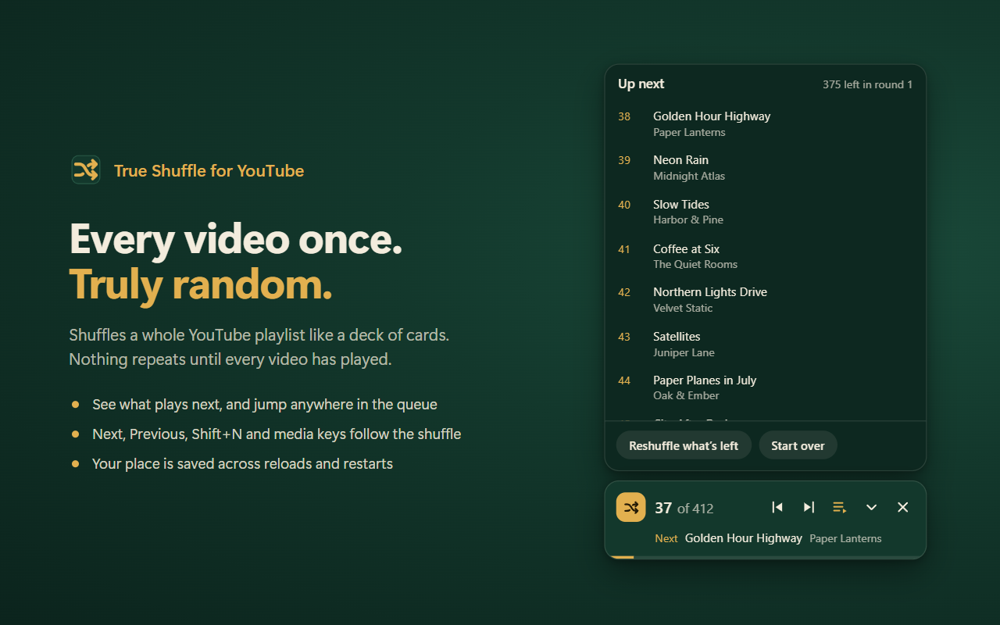

# True Shuffle for YouTube

Shuffles a YouTube playlist like a deck of cards: every video plays exactly once, in a truly random order, before anything repeats.

## Install

Works in Chrome, Edge, Brave, Opera, Vivaldi and other Chromium browsers (version 111 or newer), and in Firefox 140 or newer.

Store listings are on their way. Until then, install it by hand in a Chromium browser:

1. Download `true-shuffle-for-youtube-v1.0.0.zip` from the [latest release](https://github.com/lorenzoGT2007/true-shuffle-for-youtube/releases/latest) and unzip it somewhere permanent (for example `Documents\True Shuffle`). The browser loads the extension from there, so leave it in place.
2. Open the extensions page: `chrome://extensions`, `edge://extensions` or `brave://extensions`.
3. Switch on **Developer mode**.
4. Click **Load unpacked** and choose the folder that contains `manifest.json`.
5. YouTube tabs that were already open pick it up by themselves. If one doesn't, reload it.

Firefox only keeps add-ons signed by Mozilla, so there it comes from Firefox Add-ons once the listing is up. To try it before that, unzip the `-firefox` zip from the latest release, open `about:debugging#/runtime/this-firefox`, click **Load Temporary Add-on…** and pick its `manifest.json`. It stays until Firefox closes.

## Use

- Play any video from a playlist and the shuffle turns on by itself: the round button at the bottom right lights up with your progress. Click it to open the card.
- On a playlist's own page, click the round button to start with a random video.
- When a video ends, the next one comes from the shuffle. The player's Next and Previous buttons, Shift+N / Shift+P and your keyboard's media keys follow it too.
- Skipping through a video with the time bar is fine. Drag it to the very end (or press End) to skip to the next shuffled video; while you hold the bar nothing changes until you let go.
- The card shows how far you are, what plays next, and an "Up next" list you can jump around in. The arrow folds it into the small button; the × stops shuffling that playlist in this tab (your place is kept, and the round button starts it again).
- Pick a video yourself from the playlist and it counts as played.
- The toolbar icon shows the same controls plus settings. Switch off "Turn on by itself when a playlist plays" if you'd rather start it yourself every time.
- **Hide watched videos** (in the toolbar popup, or Alt+Shift+U): videos you've watched at least 90% of disappear from Home, Subscriptions, channel Videos tabs, search results and playlists (Watch later too), judged by the red bar under the thumbnail or YouTube's "Watched" label, including the ones that load as you scroll. "Filter options" sets the share and can also hide videos you've only started. The video you're watching always stays.
- **On any playlist page** (Watch later too): a search box above the list filters by title or channel as you type, and a menu shows the list by title, duration, channel, date added (when YouTube shows it), unwatched first, or in the playlist's own order. It only changes what you see; your playlist stays exactly as it is. On a long playlist, "Load all" scrolls through it for you first, so search and sort cover every video. **Play** plays exactly the videos shown, in that order; **Shuffle** plays them shuffled (this takes the place of that playlist's shuffle; "Shuffle whole playlist" in Up next goes back to all of it).
- **Videos that vanish**: when you open a playlist, True Shuffle remembers its videos. Next time, if some were removed or became private or deleted, a small notice above the list names them with their old titles ("Seen it" puts it away). For a long playlist, use "Load all" so it can see the whole list. The history, with a CSV export, is in the options. Watch later and Liked videos aren't checked, since videos come and go there because of you.

## Why it's more random than YouTube's shuffle

- It reads the whole playlist (YouTube's shuffle only mixes the part of a long playlist it has loaded).
- One shuffled deck per round: no repeats until every video has played. Your place is saved, so it survives reloads and restarting the browser.
- Uniform Fisher-Yates shuffle with the browser's cryptographic random generator.
- Optional: never the same channel twice in a row.
- When a new round starts, the last songs you heard are kept away from the start of it.

## Good to know

- Mixes (YouTube's endless auto-generated lists) can't be shuffled. Save the songs to a playlist instead.
- If you browse other pages while the miniplayer plays, YouTube's own order takes over until you come back to the video page. The card then offers "Resume shuffle".
- Private playlists, Watch later and Liked videos work while you're signed in to YouTube.
- Nothing leaves your browser. The extension only talks to youtube.com and keeps its state in the browser's extension storage. See the [privacy policy](PRIVACY.md).

## Support

True Shuffle is free and has no ads. If it makes your playlists better, you can [buy me a coffee](https://buymeacoffee.com/lorenzogt). ☕

Found a bug or have an idea? [Open an issue](https://github.com/lorenzoGT2007/true-shuffle-for-youtube/issues).

## License

[MIT](LICENSE). True Shuffle is an independent project, not affiliated with or endorsed by YouTube or Google.
